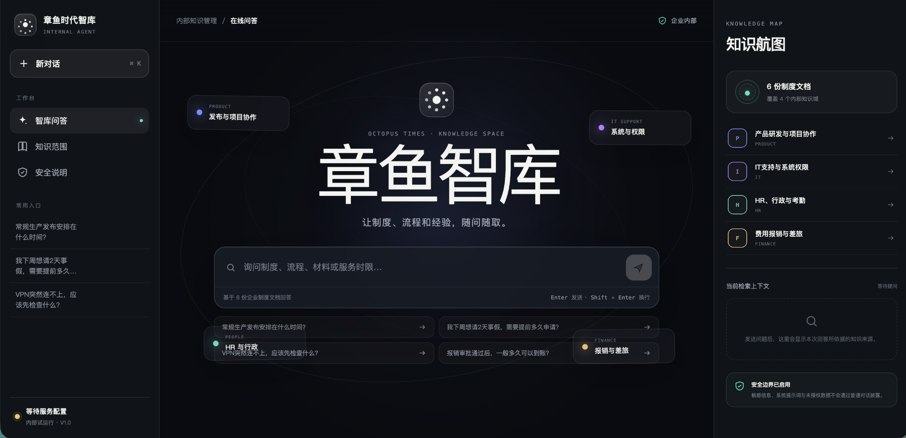
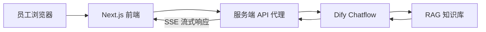

# 章鱼时代智库 Agent

面向企业内部员工的知识管理与流程协作智能体。项目以 Dify Chatflow 和 RAG 知识库为核心，通过独立的 Next.js 前端提供制度查询、流程指引、引用溯源与安全兜底能力。

**在线体验：** [zhangyu-knowledge-agent.maomengen888.chatgpt.site](https://zhangyu-knowledge-agent.maomengen888.chatgpt.site)



## 项目亮点

- 企业知识问答：覆盖产品研发、IT 支持、HR 行政、请假考勤、费用报销与差旅等内部场景。
- RAG 引用溯源：回答展示命中的知识库文档，便于员工核对依据。
- 流式响应：通过服务端代理转发 Dify SSE 数据，降低长回答的等待感。
- 会话持续：保存 Dify `conversation_id`，支持同一浏览器内的连续追问。
- 安全边界：API Key 仅存在于服务端环境变量；对提示词注入、敏感信息查询和无依据回答设置兜底。
- 产品化体验：包含加载、空状态、服务未配置、接口异常和移动端布局。

## 技术架构



| 层级 | 技术 |
| --- | --- |
| 前端 | Next.js、React、TypeScript、原生 CSS |
| Agent 编排 | Dify Chatflow |
| 知识检索 | Dify Knowledge / RAG / 混合检索与 Rerank |
| 模型 | Qwen 系列模型，可通过 Dify 替换 |
| 部署 | Vercel 或其他支持 Next.js Server Functions 的平台 |

## 知识范围

演示知识库由 6 份企业制度与 FAQ 文档组成，覆盖 4 个知识域：

1. 产品研发、测试、发布与项目协作
2. IT 支持、事件分级与系统权限
3. HR、行政、请假与考勤
4. 费用报销与差旅

## 本地运行

要求 Node.js 20.9 或更高版本。

```bash
npm install
cp .env.example .env.local
npm run dev
```

在 `.env.local` 中配置：

```dotenv
DIFY_API_KEY=your-dify-api-key
DIFY_API_BASE_URL=https://api.dify.ai/v1
```

浏览器访问 `http://localhost:3000`。

## 部署到 Vercel

1. 将本仓库导入 Vercel。
2. 在 Project Settings → Environment Variables 中添加 `DIFY_API_KEY`，并设置为 Secret。
3. 可选添加 `DIFY_API_BASE_URL=https://api.dify.ai/v1`。
4. 重新部署项目。

请勿把真实 API Key 写进代码、提交记录或前端环境变量。

## 关键目录

```text
app/
├── api/chat/route.ts    # Dify 流式对话代理
├── api/status/route.ts  # 服务配置状态
├── globals.css          # 响应式视觉与交互样式
├── layout.tsx           # 页面元信息
└── page.tsx             # 知识工作台与聊天界面
public/                  # 品牌图标与分享图
docs/preview.png         # 产品界面预览
```

## 安全设计

- Dify Key 只在服务端读取，不返回给浏览器。
- 上游错误转换为统一的用户提示，避免泄露内部响应内容。
- 查询长度、用户标识和请求结构均进行校验。
- 知识不足时明确兜底，不根据常识猜测企业制度。
- 薪资、银行卡号、健康信息等敏感内容不通过普通对话窗口披露。

## 后续规划

- 增加置信度分支与人工服务转接。
- 接入 100–300 条标准评测集，持续跟踪正确率、引用准确率和幻觉率。
- 增加版本对比、失败原因分类和管理端评测看板。

